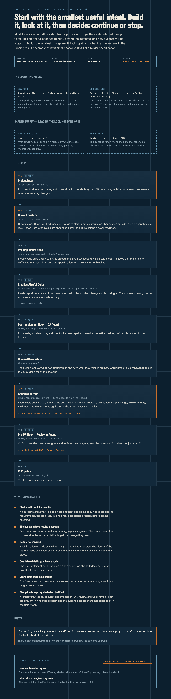
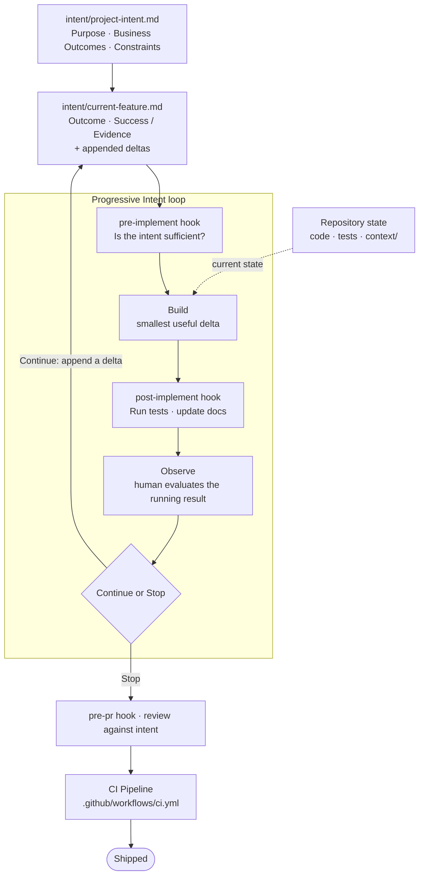

# Intent-Driven Engineering Starter

**This is the canonical starting point for Intent-Driven Engineering.**

Most AI coding workflows start with a prompt and hope the model infers what you meant. Intent-Driven Engineering flips that: you write the *intent* down first, and every agent, hook, and check in this repo reads that intent before it touches code.

Learn the methodology in depth at **[learnteachmaster.org](https://learnteachmaster.org)** and **[intent-driven-engineering.com](https://intent-driven-engineering.com)**.

## Install

This repo is a Claude Code plugin and its own marketplace. One line adds the marketplace and installs the plugin:

```bash
claude plugin marketplace add kendallmark3/intent-drive-starter && claude plugin install intent-drive-starter@intent-drive-starter
```

Then, in any project, start a Claude Code session and run:

```text
/intent-drive-starter:start <the outcome you want>
```

That creates `intent/current-feature.md` in your project, records the outcome and how success will be judged, and builds the first thing you can look at. The scripts need `bash`.

Prefer the files in your own repo? Clone or copy this repository instead and use it as the scaffold; see [Getting started](#getting-started).

## The operating model

### Intent-Driven Engineering

The overall engineering approach: the human states what is wanted and how success will be judged; the AI reads the repository and works out how to get there.

### Progressive Intent

The preferred way Intent-Driven Engineering evolves software.

**Repository State + Next Intent = Next Repository State**

**Intent → Build → Observe → Learn → Refine → Continue or Stop**

1. **Intent.** Write the smallest useful expression of what is wanted in [`intent/current-feature.md`](intent/current-feature.md). Only *Outcome* and *Success / Evidence* are needed to start; add Inputs, Outputs, or Constraints / Boundaries when they are real. The project-level version lives in [`intent/project-intent.md`](intent/project-intent.md).
2. **Build.** [`hooks/pre-implement.sh`](hooks/pre-implement.sh) checks that the intent is sufficient, not that it is a complete specification. With the plugin installed, code edits are blocked until it passes; Markdown is never blocked, and projects without an intent file are left alone. The [feature-planner skill](skills/feature-planner/SKILL.md) then finds the smallest useful delta from the current repository state, and it gets built into something observable.
3. **Observe.** The [`post-implement`](hooks/post-implement.md) hook runs tests and updates docs. Then the human evaluates the actual running result.
4. **Learn and refine.** Ordinary feedback is enough: "keep this", "change that", "this is too complicated". The [progressive-intent skill](skills/progressive-intent/SKILL.md) turns it into a delta, appended to the same intent file using [`templates/delta-template.md`](templates/delta-template.md). The original intent is not rewritten.
5. **Continue or Stop.** Every cycle ends in that decision. Repeat only while another change produces value. On Stop, the [`pre-pr`](hooks/pre-pr.md) hook, review against the intent, and CI ([`.github/workflows/ci.yml`](.github/workflows/ci.yml)) are the last gates.

### Who owns what

| Human | AI |
| --- | --- |
| Desired outcome | Reasoning and planning |
| Authoritative inputs and required outputs | Architecture and technical choices |
| True constraints and boundaries | Implementation approach and sequencing |
| Success criteria and evidence | Code structure and testing approach |
| Observations of the running result | |
| The continue or stop decision | |

The rule is **minimum sufficient constraint**: structure the boundary, not the reasoning. The repository is the source of current-state truth, so the human does not restate what the code, tests, and [`context/`](context/) already say.

Progressive Intent does not mean no architecture, testing, security, documentation, QA, review, CI, or constraints. It means they are applied when the problem and evidence justify them, instead of being predicted up front in the first intent.

### What a cycle looks like

The first intent:

```markdown
## Outcome
Operators can see the status of nightly jobs on one page.

## Success / Evidence
Last night's jobs appear with their status.
```

After seeing the result, the human says: *"Keep the layout, but the dashboard feels too busy. Make failures obvious."* That becomes a delta appended to the same file:

```markdown
# Intent Delta

## Observation
The dashboard feels too busy.

## Keep
The layout.

## Change
Make failures obvious.

## Evidence
A failed job stands out without reading the whole page.
```

## What's in the repo

- [`intent/`](intent/) — the project intent and the current feature intent with its deltas.
- [`context/`](context/) — architecture, business rules, glossary, integrations, security: what the code alone cannot show.
- [`.claude-plugin/`](.claude-plugin/) — the plugin and marketplace manifests that make the repo installable.
- [`skills/`](skills/) — [start](skills/start/SKILL.md), [feature-planner](skills/feature-planner/SKILL.md), and [progressive-intent](skills/progressive-intent/SKILL.md).
- [`agents/`](agents/) — planner, developer, QA, reviewer roles. A normal Claude session can run the whole loop; the roles are there when you want to split it.
- [`hooks/`](hooks/) — pre-implement (a runnable check, enforced by [`hooks.json`](hooks/hooks.json) when installed as a plugin), plus post-implement and pre-pr guidance.
- [`templates/`](templates/) — feature, delta, bug, ADR.
- [`tests/`](tests/) — tests for the pre-implement check and its hook, run by CI.

## Architecture



[View the HTML version](docs/architecture.html) (open locally, or enable GitHub Pages on this repo to serve it live).

<details>
<summary>Mermaid source (renders inline on GitHub)</summary>



</details>

## Getting started

With the plugin installed, `/intent-drive-starter:start` does steps 2 and 3 for you. Working from a clone of this repo:

1. Fill out [`intent/project-intent.md`](intent/project-intent.md) with your project's purpose, business outcomes, and constraints.
2. Write the Outcome and Success / Evidence for your first feature in [`intent/current-feature.md`](intent/current-feature.md).
3. Run `hooks/pre-implement.sh`, then build the smallest thing you can look at.
4. Look at it, say what you think, and append a delta. Continue or stop.
5. Add to [`context/`](context/) only what the repository cannot show on its own.

## Learn more

- **[learnteachmaster.org](https://learnteachmaster.org)** — canonical home for Learn/Teach/Master and where Intent-Driven Engineering is taught in depth.
- **[intent-driven-engineering.com](https://intent-driven-engineering.com)** — the methodology itself, in detail.
